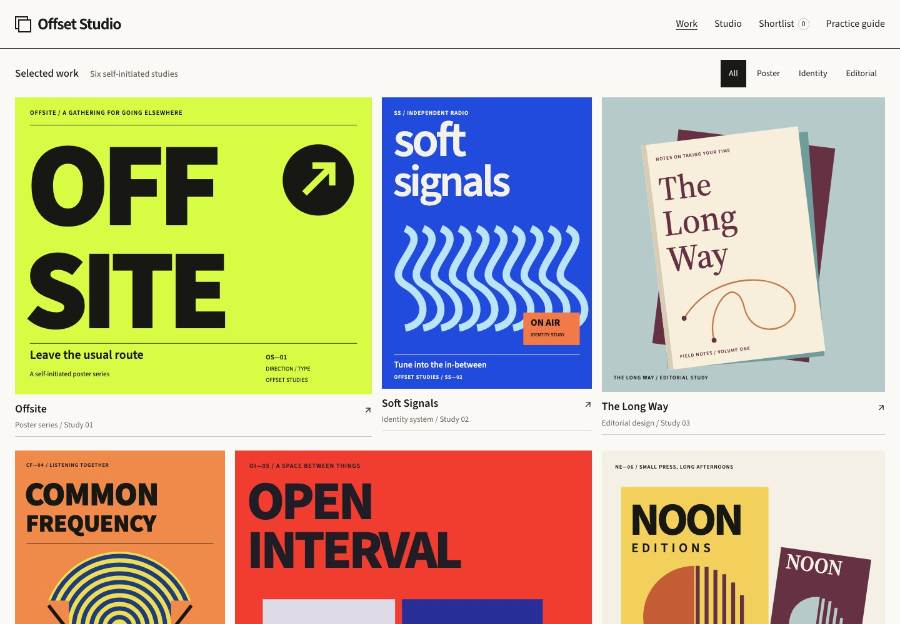
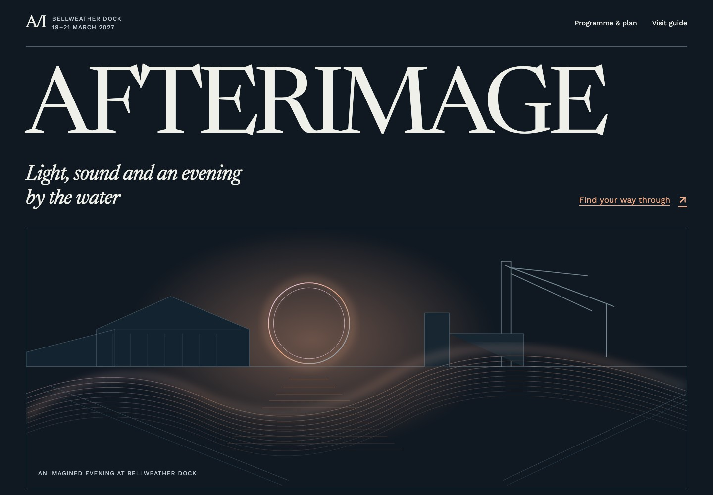
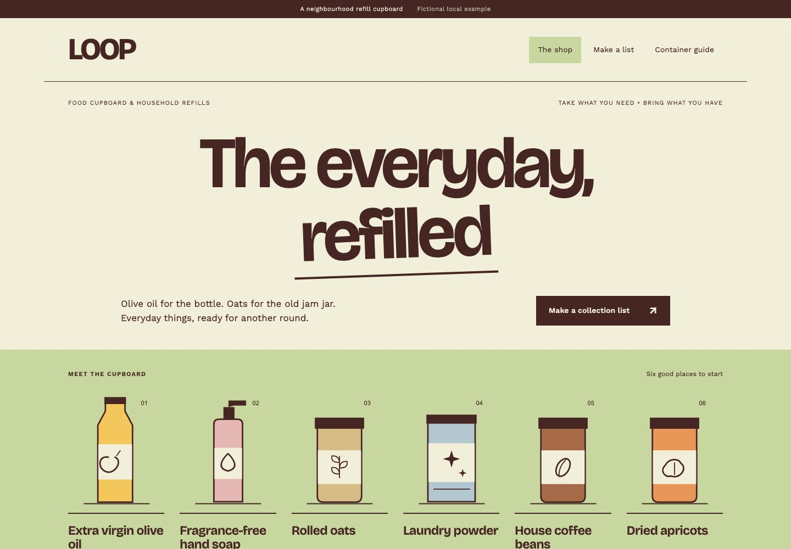
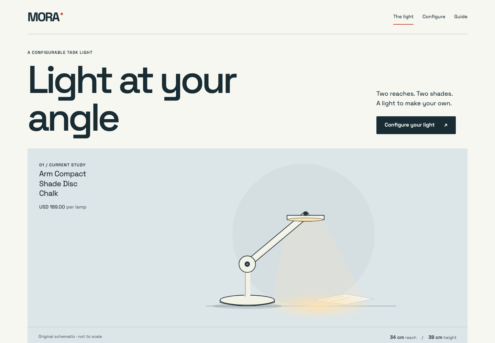
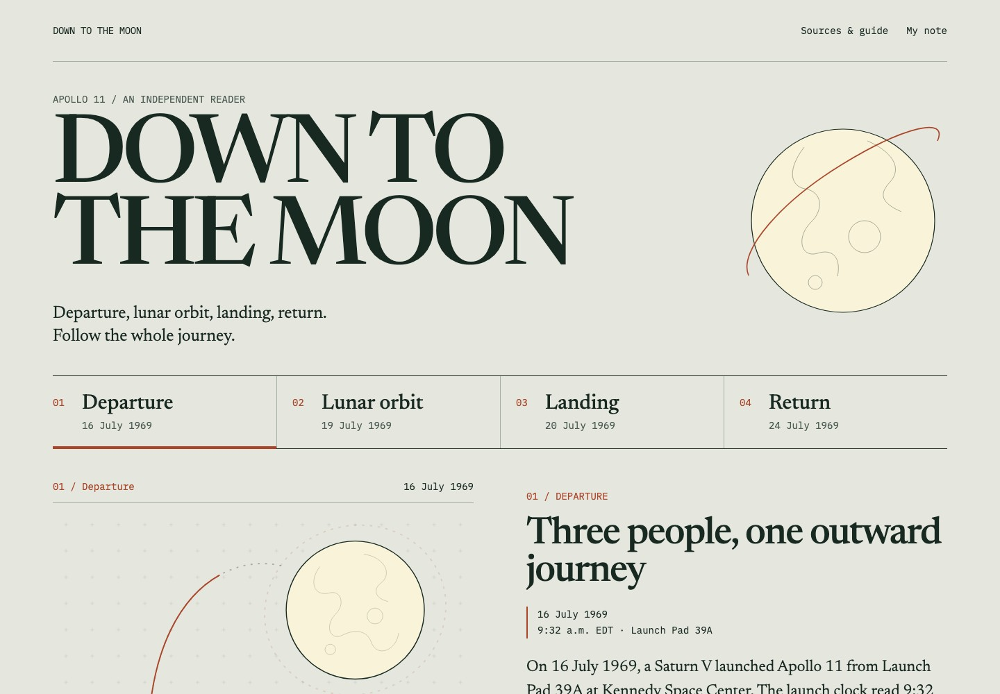
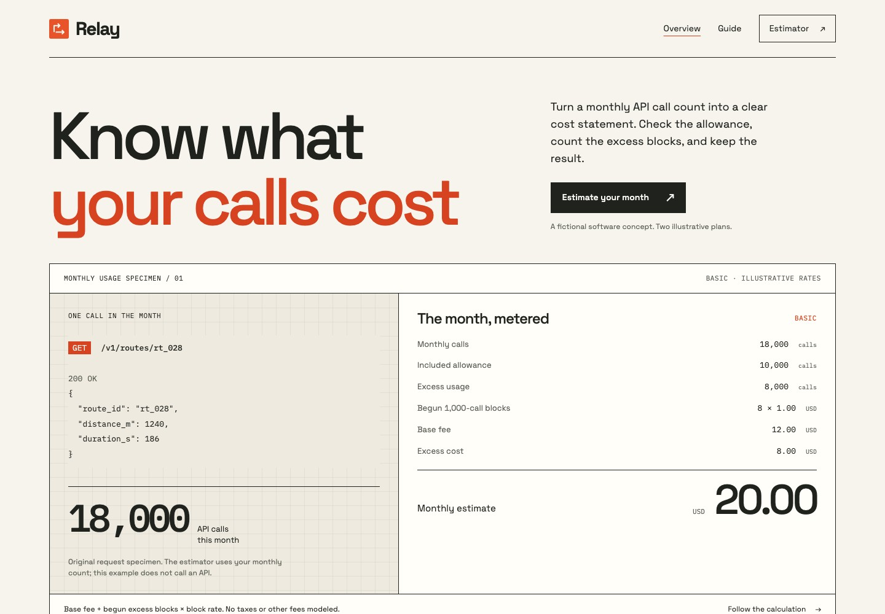

# Begin

**Give your AI the skills to build the website you have in mind**

We've spent years turning people's ideas into websites. Now, we're putting that expertise in your hands.

Begin brings design methods, professional web development guidance and working examples into the AI Agent you already use. Start with your idea, shape a website that feels like yours, and keep improving it.

[Get started](#start-here) · [Explore the examples](showcase/README.md) · [Visit the website](https://begin-skills-site.kiedis-a11.workers.dev/)

## Made with Begin

Original examples, built and refined with Begin. Open an example for larger screenshots, phone views and editable source.

| | |
| --- | --- |
| [](showcase/README.md#offset-studio) | [](showcase/README.md#afterimage) |
| **[Offset Studio](showcase/README.md#offset-studio)** · Creative portfolio | **[AFTERIMAGE](showcase/README.md#afterimage)** · Arts and events |
| [](showcase/README.md#loop) | [](showcase/README.md#mora) |
| **[LOOP](showcase/README.md#loop)** · Local retail | **[MORA](showcase/README.md#mora)** · Product and configurator |
| [](showcase/README.md#down-to-the-moon) | [](showcase/README.md#relay) |
| **[Down to the Moon](showcase/README.md#down-to-the-moon)** · Educational publishing | **[Relay](showcase/README.md#relay)** · Software and developer tools |

These are original demonstration projects. Commercial names and prices are illustrative; the Apollo reader uses sourced historical facts. The screenshots show the running websites included in the pack. [See the phone views, source and capture details](showcase/README.md).

## Start here

Open your website folder in Codex and copy:

> Install Begin from https://github.com/cogine-ai/begin-skills/tree/begin-skills-v0.1.0-beta.1 using Codex's native plugin manager. Preserve my existing instructions and website files, then help me start.

For Claude Code, ask it to use its native plugin manager with project scope. Both plugins include all fifteen Skills and their complete resources. The standard Skills CLI is another installation path; a ZIP is the fallback. Follow [installation](INSTALL.md), [Codex](plugins/begin-skills/docs/CODEX.md) or [Claude Code](plugins/begin-skills/docs/CLAUDE_CODE.md).

Then describe the website you want:

> Use Begin to help me build a website for my independent design studio. I want potential clients to understand my work and get in touch.

Begin helps your Agent clarify the brief, choose useful references, build, preview and refine. Project setup uses `begin-setup`; making and changes use `begin-website`. Your Agent keeps a short `BEGIN.md` record so you can continue later.

[Quick Start](plugins/begin-skills/docs/QUICKSTART.md) · [How people use Begin](plugins/begin-skills/docs/USAGE_MODEL.md)

## What's inside

- **15 Skills** covering setup, website making, design, content, frontend, backend, data, security, services, publishing, quality, architecture, Learn Products, Writing Docs and diagrams.
- **53 design variants across 52 original scenarios**, with editable source, reference guidance and actual desktop/phone captures.
- **Four creation starters** for a professional service, creative portfolio, product introduction and editorial/documentation website.
- Interactive component examples, researched articles, usable documentation and a persistent enquiry feature with server validation and owner access checks.
- Native Codex and Claude Code plugin catalogs, portable Skills, preview helpers, guides and service recipes.

[Full contents](plugins/begin-skills/CONTENTS.md) · [Account, payment and private-data extensions](plugins/begin-skills/docs/EXTENSIONS.md) · [Verified host support](plugins/begin-skills/SUPPORT.md)

## Explore a complete example

Clone this repository, then serve its examples locally:

```sh
git clone --depth 1 https://github.com/cogine-ai/begin-skills.git
cd begin-skills
python3 -m http.server 8000 --bind 127.0.0.1 --directory plugins/begin-skills/skills/begin-design/assets
```

Open `http://127.0.0.1:8000/composition-cases/offset/site/`, or choose another path from the [showcase](showcase/README.md). Each example includes its own fonts, artwork, working pages and notices. Python 3 is only needed for this optional local preview.

The [Quick Start](plugins/begin-skills/docs/QUICKSTART.md) covers creating your own project. Replace sample content and contact destinations before sharing it.

## Help us make it better

Show us what you made, or tell us where you got stuck. A screenshot, a link or a short note is enough. [Share an experience or report a problem](https://github.com/cogine-ai/begin-skills/issues/new/choose). For a possible vulnerability, use [private security reporting](SECURITY.md).

## Release and license

The current pack is **0.1.0-beta.1**. Read [Status](plugins/begin-skills/STATUS.md) for its actual verification scope and [Releases](https://github.com/cogine-ai/begin-skills/releases) for fixed versions and backup downloads.

Begin-authored material uses [MIT](LICENSE). Third-party fonts and other resources keep their original licenses. See [license details](plugins/begin-skills/LICENSE_STATUS.md), [showcase credits](showcase/NOTICES.md) and [contribution guidance](CONTRIBUTING.md).
