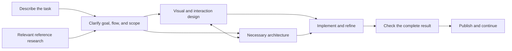

# Begin product and Skill review: round two

Date: 2026-10-09. Reviewed source: the current uncommitted `0.1.0-dev.2` candidate.

This document records the second-round findings and proposals. The owner subsequently confirmed researched articles/manuals and progressively verified account/payment/private-data extensions. Skill names follow the accepted Learn Products and Writing Docs naming; the reviewed runtime evidence remains the stated dev.2 snapshot. It does not change Skill behavior, approve a new package structure, or add a platform. The current contents and status remain in [CONTENTS](../CONTENTS.md) and [STATUS](../STATUS.md). Existing runtime results were inspected, not rerun in this review.

## Main assessment

Begin has useful professional breadth and several concrete resources. Its depth is uneven. The next improvement should make an ordinary person's website work easier and the result better: a clear first-use experience, explicit intended behavior, excellent task-matched examples, and reliable completion of the central action.

Three findings matter most:

1. Setup and making are already separate Skills. The inventory and usage presentation obscure that separation.
2. Product definition has no clear owner. A website purpose, a reference map, visual direction, and engineering architecture do not together guarantee a usable specification.
3. Attractive references and sound principles have not yet become enough complete, adaptable examples. The current starters have coherent visual identities, but their task, material, and aesthetic range is narrow.

Keep the broad capability-pack direction. A small validation slice should help prioritize improvements without reducing the product to static landing pages. Ordinary people should describe the result they want, inspect it, and change it. The Agent should handle professional methods and project records.

## 1. Expand the questions before changing files

### Questions research can answer

| Question | Finding or next observation |
| --- | --- |
| Is setup actually coupled to making? | The Skill files separate them; C01 and the first-session table combine their presentation. |
| Who owns agreed requirements and acceptance? | No current Skill explicitly owns the complete contract. |
| Is design visual only? | It includes information hierarchy, visual composition, responsive behavior, and interaction. It is not a full product spec. |
| What does content mean in the actual source? | Website narrative, offer/marketing copy, and interface text. Technical explanation and procedures sit in writing. Complete article/editorial workflows are missing. |
| What exactly is a starter? | Runnable editable HTML/CSS/JS, original assets, example content, metadata, behavior, and editing guidance. |
| Are guides and delivery duplicate workflows? | Guides are reference material; setup is an action. Pack distribution and website publication have different subjects. |
| Do important Skills have deep resources? | Some have a single short reference; backend has a real local feature; service categories mostly have guidance rather than complete integrations. |
| Are the cited references current and directly applicable? | Current primary snapshots were checked separately from installed adaptations. Some methods are useful, but provider, host, and company-specific details need adaptation. |
| Can an unfamiliar person make a good result from rough material? | No ordinary-person first-use trial establishes this yet. |
| Does Begin improve the same Agent's result? | A matched baseline comparison is still needed. |
| Can the owner change, undo, and continue without losing identity or functionality? | Synthetic continuation and scoped repair exist. Owner-led editing and undo need their own observations. |
| Do Skills trigger correctly beside other installed Skills? | Existing trials explicitly invoked the website entry and ignored the user's host configuration. Coexistence and natural discovery remain untested. |
| Does the reference library cover common tasks and available materials? | It favors creative studios, portfolios, and software marketing; low-asset, editorial, documentation, and richer functional cases need coverage. |
| Is broader coverage worth its maintenance cost? | Add depth where a task fails; measure correction effort, dependency burden, and ongoing usefulness. Source volume is not the success metric. |

### Product choices that follow those facts

- What complete outcomes will the first public edition promise, and which are guided extensions?
- Should product definition become an independently activated Skill, or first a clearly owned method inside making?
- Which article, manual, and content-site tasks should be complete in the first edition?
- Which few examples demonstrate both accessibility to ordinary owners and professional breadth?

Naming, file count, and mandatory stage sequences should follow these choices and actual task trials. They do not need to be assigned to the user as implementation decisions.

## 2. Global comparison with strong Skill sets

These are selected first-party comparators with different strengths. This review does not establish a worldwide ranking, user popularity, or measured comparative performance.

| Set | What its source does well | Begin's potential advantage | What to transfer; what to adapt |
| --- | --- | --- | --- |
| Matt Pocock | Separates project setup, human-selected workflows, professional capabilities, specifications, and handoff records. | A website owner can work through ordinary conversation and a visible result. | Transfer clear responsibilities and useful persistent artifacts. Keep detailed engineering trackers conditional. |
| Superpowers | Makes intent, specification, implementation planning, and checks explicit; current brainstorming scales paths by task type. | Small website work can remain quick and understandable. | Transfer the behavior contract and proportionate depth. Investigate forceful activation and approval gates before adopting them. |
| Anthropic Skills | Demonstrates self-contained resources, progressive loading, worked tools, realistic evaluation, and reader testing. | Begin can connect several professional decisions into an owner-specific website. | Transfer practical resources and outcome comparison. Example-repository status does not prove every host or task works. |
| Vercel Agent Skills | Provides narrow expertise, prioritized rules, and concrete incorrect/correct examples. | Begin can choose a fitting implementation across website tasks and existing stacks. | Transfer conditional rules and worked repairs. Code guidance alone does not establish visual quality. |

Sources inspected: [Matt README](https://github.com/mattpocock/skills/blob/b0618bc436ad893b3c5e84e55fba86586d34a404/README.md), [Superpowers brainstorming](https://github.com/obra/superpowers/blob/8ca22dba9a94f28898bbce59f2537ff4d87c747d/skills/brainstorming/SKILL.md), [Anthropic skill creator](https://github.com/anthropics/skills/blob/683bc88e56f3e09ba94f7055977f3d3aa499f202/skills/skill-creator/SKILL.md), [Vercel React guidance](https://github.com/vercel-labs/agent-skills/blob/063bee94c3f4df8453406c830b0a7df0f2860278/skills/react-best-practices/SKILL.md).

The strongest opportunity is to turn professional judgment into an attractive, accurate, editable result with little owner effort. A catalog containing all the same expertise words is easy to imitate. Consistent task completion, original examples, and good adaptation are harder to reproduce. This is a product hypothesis to test.

## 3. Resolve the six structural questions

### 3.1 Installation, project setup, and work

- **Install or update the pack:** a host delivery operation.
- **Set up the workspace:** connect existing instructions and `BEGIN.md`; usually once per project, with repair or reconciliation after a material change.
- **Do the work:** build, edit, research, explain, diagnose, or publish the current website task.

The separate `begin-setup` and `begin-website` files already express this. Split their presentation in the contents and first-use guide. Making still needs to inspect actual files, commands, and tools; that does not mean repeating setup or onboarding. A first-use experience can offer minimal preparation without making the owner manage a technical sequence.

### 3.2 Specification, research, design, and architecture

| Responsibility | Question it answers | Useful output |
| --- | --- | --- |
| Product definition | What should people accomplish, and what exactly will work? | Goal, actors, main/alternate flow, meaningful states, scope, constraints, acceptance conditions |
| Comparable-product research | How do real products organize the relevant task, and what transfers? | Evidence-backed page/flow map and adaptation rationale |
| Website design | How should people understand and use this surface, and what gives it character? | Content hierarchy, interaction presentation, composition, typography, imagery, responsive treatment |
| Engineering architecture | How should rules, records, interfaces, and dependencies support that behavior? | Ownership, boundaries, interfaces, consequential tradeoffs, compatibility and checks |

For a small site, the product definition can be a few lines using facts already provided. A private inbox, payment, booking, or multi-session feature needs a more durable behavior contract. `BEGIN.md` should remain a concise continuity note that links to relevant artifacts; it should not accumulate every requirement, decision, and transcript.

A dedicated `begin-spec` is a reasonable candidate, not a conclusion established by an empty table cell. First define the owner and minimum output. Trial both a making task and a request to define behavior without implementation. Use the activation and repetition results to decide whether an independent Skill improves the experience. Reuse existing specifications when sufficient; a new `SPEC.md` is not required for every site.

### 3.3 Order and user expectations

Present the understandable progression separately from the capability catalog. Engineering architecture should appear as a normal capability, rather than an appendix. Resolve permissions, private data, payment ownership, and significant service constraints early. Visual exploration and engineering constraints can inform each other. Static sites may have very little architecture work; a copy edit can begin directly from current source.

This is a communication map. It is not an instruction to invoke every Skill or wait for stage approval. Setup remains a separate workspace action. Content work supports the relevant parts of the progression.

### 3.4 Content jobs

| User task | Current fit | Proposed treatment |
| --- | --- | --- |
| Offer, about story, services, project cases, page navigation | Website content | Add content inventory, page intent, original examples, and context-sensitive message choices. |
| Landing-page marketing and purchase explanation | Website content has an initial method | Add buyer alternatives, objections, actual evidence, and clear terms; judge conversion separately from copy preference. |
| Labels, form help, validation, empty/error/success messages | Website content with interface context | Check wording against the actual action and state. |
| Technical explanation, setup, operation, troubleshooting | Writing Docs | Add document-type selection and an unfamiliar-reader task. |
| Technical or marketing articles | Partial support | Add research, argument, factual sourcing, article structure, and layout examples if these are promised tasks. |
| Content-site organization | Product/content structure contributes | Needs an original index/article or documentation exemplar. |
| Editorial calendar, CMS workflow, newsletter, distribution | Not substantially delivered | Treat as separate later scope unless real usage makes it necessary. |

Keep the current two writing capabilities with clearer jobs before adding more names. Articles and manuals are useful website content; a full content operation has additional requirements. Move Begin's own approved brand story into Begin-owned marketing material when editing the pack: its presence inside generic content guidance may bias another owner's writing. This is an inferred risk, not an observed contamination result.

### 3.5 Starters, templates, and components

A starter is a complete example website that can be copied and adapted. Structure and visual treatment work together to demonstrate a coherent result. Keep that usable unit. Internally identify the content contract, design tokens, behavior, dependencies, and editable sections. Extract reusable seams when actual adaptations reveal them.

Do not ask an ordinary owner to choose a structure pack, style pack, component pack, and integration pack before seeing their website. Do not freeze every future site into one schema. A reference should help the Agent make a good decision while the resulting content and identity belong to the owner.

### 3.6 Guides and two kinds of delivery

| Layer | Purpose |
| --- | --- |
| Skills | Instructions and task-local professional resources |
| Complete examples and components | Editable implementation and concrete decisions |
| User guides | Install, start, edit, continue, recover, and find help |
| Project setup | Configure guidance in the selected workspace |
| Pack distribution | Version, bundle, install, update, and remove the capability pack |
| Website publishing | Put the owner's result in its intended environment and verify it |

Guides can explain setup and remain useful afterward. They should not be merged wholesale into the executable setup Skill. Use clear labels such as “Pack installation and updates” and “Website publishing.” Current guide copies under the website Skill serve portable packaging; retain one canonical source and explain the packaging location. Reconsider location only when a native import trial demonstrates a discovery problem.

## 4. Individual review of all fifteen Skills

The advantages below describe source fit and concrete resources. They are not measured superiority claims. Each item selects one to three relevant strong sources. Where a suitable Skill was not found in the inspected sets, an official method or standard is explicitly identified instead.

### 01. `begin-setup`

**Primary comparison:** [Matt project setup](https://github.com/mattpocock/skills/blob/b0618bc436ad893b3c5e84e55fba86586d34a404/skills/engineering/setup-matt-pocock-skills/SKILL.md).

- **Useful current distinction:** installation is separate from workspace configuration; existing instructions and accepted choices are preserved. The independent repeat-run trial left the workspace byte-identical.
- **Gap to repair:** first-use presentation, native host lifecycle, and behavior when the complete pack coexists with other installed resources.
- **Resource improvement:** one worked existing-project setup/repair example with small before/after instruction changes and a clear making request.
- **Tradeoff to keep:** no architecture interview or mandatory accounts during setup. Making checks current conditions without redoing configuration.

### 02. `begin-website`

**Comparisons:** [Matt ask-matt](https://github.com/mattpocock/skills/blob/b0618bc436ad893b3c5e84e55fba86586d34a404/skills/engineering/ask-matt/SKILL.md); [Superpowers brainstorming](https://github.com/obra/superpowers/blob/8ca22dba9a94f28898bbce59f2537ff4d87c747d/skills/brainstorming/SKILL.md). These are workflow comparators, not equivalent ordinary-person website products.

- **Useful current distinction:** working preview, concrete edit, central action, source preservation, and continuity; creation and preview helpers are included.
- **Gap to repair:** minimum behavior/spec ownership, natural activation, ordinary-person use, and integrated functional work. Current trials used explicit invocation.
- **Resource improvement:** a short task-sized behavior method and one complete owner journey using current source and project records.
- **Tradeoff to keep:** one understandable making entry; no embedded catalog or mandatory call chain in the Skill body. Specialist work remains directly useful when requested.

### 03. `begin-learn-products`

**Comparisons:** [NN/g task analysis](https://www.nngroup.com/articles/task-analysis/); [NN/g wireflows](https://www.nngroup.com/articles/wireflows/). These are professional UX methods, not Agent Skills. The local repo-deconstruction methods provide a related evidence discipline but are weaker primary matches for external product UX.

- **Useful current distinction:** observed, documented, source-backed, and inferred behavior are separated. Page, role, state, data, and action maps remain task-specific.
- **Gap to repair:** current provenance emphasizes repository analysis; no complete real-page-to-task map and original proposal demonstrates the method across a dynamic flow.
- **Resource improvement:** one annotated comparable flow with the relevant screen/state context, access limits, recovery behavior, and original adaptation. Screenshots cannot reveal a database schema.
- **Tradeoff to keep:** research depth follows the decision. Do not recreate every competitor feature or require a diagram for a short comparison.

### 04. `begin-architecture`

**Comparisons:** [Matt codebase-design](https://github.com/mattpocock/skills/blob/b0618bc436ad893b3c5e84e55fba86586d34a404/skills/engineering/codebase-design/SKILL.md); [Matt domain-modeling](https://github.com/mattpocock/skills/blob/b0618bc436ad893b3c5e84e55fba86586d34a404/skills/engineering/domain-modeling/SKILL.md); [Anthropic architecture](https://github.com/anthropics/knowledge-work-plugins/blob/ae1513ea94dcb74a7f1505ddcf3b0ec3fab327f1/engineering/skills/architecture/SKILL.md).

- **Useful current distinction:** website owner, visitor, customer, payer, and receiver; source tracing, rule/data ownership, meaningful interfaces, and change compatibility.
- **Gap to repair:** principles outweigh complete decision examples. The appointment/deposit trial produced a proposal, not a verified structural improvement.
- **Resource improvement:** one static case with minimal structure and one functional case comparing two plausible designs, serious tradeoffs, affected source, and behavior checks.
- **Tradeoff to keep:** optional decision records, existing vocabulary, and small boundaries. Avoid default queues, shared layers, or enterprise documentation. Intended behavior is an input to architecture.

### 05. `begin-design`

**Comparisons:** [Anthropic frontend-design](https://github.com/anthropics/skills/blob/683bc88e56f3e09ba94f7055977f3d3aa499f202/skills/frontend-design/SKILL.md); [Emil design engineering](https://github.com/emilkowalski/skill/blob/e8a175de22ae1e49370fc144c1f3bb9aeedf988d/skills/emil-design-eng/SKILL.md); [Emil prototype](https://github.com/emilkowalski/skill/blob/e8a175de22ae1e49370fc144c1f3bb9aeedf988d/skills/prototype/SKILL.md).

- **Useful current distinction:** preserves owner choices, handles limited material, explains reference transfer, and keeps libraries optional.
- **Gap to repair:** no completed reference-led redesign, visible alternatives, or independent owner preference. Product/visual responsibilities remain ambiguous.
- **Resource improvement:** two genuinely different rendered directions using the same facts and assets; explain the recommendation and demonstrate a substantial edit. Add selected interaction examples when needed.
- **Tradeoff to keep:** no universal visual bans, compulsory three variants, or advanced animation for every edit. Task fit and owner identity guide aesthetic judgment.

### 06. `begin-content`

**Comparisons:** [Corey copywriting](https://github.com/coreyhaines31/marketingskills/blob/7155a092b44a6e50c21413df2ac4854f51a28bec/skills/copywriting/SKILL.md); [Corey content strategy](https://github.com/coreyhaines31/marketingskills/blob/7155a092b44a6e50c21413df2ac4854f51a28bec/skills/content-strategy/SKILL.md).

- **Useful current distinction:** accurate owner facts, coherent voice, clear actions, and wording tested in the page context.
- **Gap to repair:** buyer alternatives, objections, owner language, rough-content inventory, original examples, and clear article scope. One short reference does not supply an editorial workflow.
- **Resource improvement:** rough material to page/message plan; offer, story, case, and form-state rewrites. Add a researched article method and exemplar if included in the promise.
- **Tradeoff to keep:** a first website need not begin with a full positioning workshop, keyword campaign, or marketing calendar.

### 07. `begin-writing-docs`

**Comparisons:** [ASD official FAQ](https://www.asd-ste100.org/STE_faq.html); [Diátaxis compass](https://diataxis.fr/compass/); [Vercel writing guidelines](https://github.com/vercel-labs/agent-skills/blob/063bee94c3f4df8453406c830b0a7df0f2860278/skills/writing-guidelines/SKILL.md). Supporting software-English checks: [Google style highlights](https://developers.google.com/style/highlights) and [Microsoft word choice](https://learn.microsoft.com/en-us/style-guide/checklists/word-choice-checklist).

- **Useful current distinction:** technical meaning, actors, conditions, quantities, exact identifiers, and obligations survive simplification; claims are checked against source.
- **Gap to repair:** tutorial versus reference selection, richer original examples, and unfamiliar-reader task completion.
- **Resource improvement:** document-type selector; one procedure, explanation, and interface reference; a rewrite showing how excessive simplification could change permission or retry meaning.
- **Tradeoff to keep:** natural software English and expressive marketing voice. The existing method is STE-inspired. Full ASD-STE100 conformity requires its rules and controlled vocabulary, with technical terminology handled under the standard; the complete standard was not audited. Official indexed text was available, while direct FAQ/tools retrieval returned 403.

### 08. `begin-diagrams`

**Comparisons:** [Mermaid official accessibility](https://mermaid.js.org/config/accessibility.html); [Mermaid CLI](https://github.com/mermaid-js/mermaid-cli/blob/f416ac5c6e42edd3a8be6d512c1008520d0c2f97/README.md); [C4 review checklist](https://c4model.com/diagrams/checklist). The latter is a semantic method, not a required four-view deliverable.

- **Useful current distinction:** current/proposed/illustrative, semantics, parsing, and rendering are separate. Four original flow/sequence/ER/state examples have local parser and render evidence.
- **Gap to repair:** repeatable optional tooling instructions, a real-source model, and final-destination readability.
- **Resource improvement:** one version-aware parse/render recipe; an actual enquiry flow; a syntactically valid but semantically wrong example with its correction.
- **Tradeoff to keep:** portable basic syntax, editable source, and prose alternatives. A documentation diagram should not add a permanent renderer to every website.

### 09. `begin-frontend`

**Comparisons:** [Vercel React guidance](https://github.com/vercel-labs/agent-skills/blob/063bee94c3f4df8453406c830b0a7df0f2860278/skills/react-best-practices/SKILL.md); [official shadcn](https://github.com/shadcn-ui/ui/blob/6ea090075cd537d3b792c6c1a625e2448b6ede26/skills/shadcn/SKILL.md); [Emil design engineering](https://github.com/emilkowalski/skill/blob/e8a175de22ae1e49370fc144c1f3bb9aeedf988d/skills/emil-design-eng/SKILL.md).

- **Useful current distinction:** keeps the existing stack, preserves owner edits, checks actual outcomes, and addresses measured responsive failures.
- **Gap to repair:** task-specific incorrect/correct examples; actual project-context/current-docs/integration cycle; framework adaptation. The separate component gallery does not establish resource discovery during independent frontend use.
- **Resource improvement:** selected conditional React/component patterns and one complete existing-project integration, including states and keyboard/touch behavior.
- **Tradeoff to keep:** static sites stay simple; do not load a full React rule library or add shadcn when the task does not use them. Detailed version-sensitive APIs follow the actual environment and official docs.

### 10. `begin-backend`

**Comparisons:** [Matt TDD](https://github.com/mattpocock/skills/blob/b0618bc436ad893b3c5e84e55fba86586d34a404/skills/engineering/tdd/SKILL.md); [Matt domain-modeling](https://github.com/mattpocock/skills/blob/b0618bc436ad893b3c5e84e55fba86586d34a404/skills/engineering/domain-modeling/SKILL.md); [Next.js data security](https://nextjs.org/docs/app/guides/data-security).

- **Useful current distinction:** a real HTTP enquiry/private-owner example with local persistence and meaningful access/failure checks. Saving, notifying, and completing an external operation remain distinct.
- **Gap to repair:** adaptation inside an existing framework, hosted identity, notification, uploads, and provider events are not complete examples.
- **Resource improvement:** integrate the enquiry into one existing website; check right-owner success, denied access, duplicate submission, uncertain response, and preserved input on failure.
- **Tradeoff to keep:** the native Node teaching server and local auth adapter are examples, not the production default. Adapt the existing runtime rather than maintaining many parallel application frameworks.

### 11. `begin-data`

**Comparisons:** [Supabase PostgreSQL best practices](https://github.com/supabase/agent-skills/blob/c9be0e931b7930f7d02126d04774d904c381e7d7/skills/supabase-postgres-best-practices/SKILL.md); [Neon generic PostgreSQL](https://github.com/neondatabase/postgres-skills/blob/27fe45e0f71ea89a6eaf9ea4d2e4068957c81c26/skills/postgres-best-practices/SKILL.md); [Neon object storage](https://github.com/neondatabase/agent-skills/blob/bfd013c352ed31b57a573e4f60263afc5fdd7f7a/skills/neon-object-storage/SKILL.md).

- **Useful current distinction:** durable record ownership, access revocation versus retention, restart versus restore, and partial file/metadata failure.
- **Gap to repair:** one 68-line reference and no own executable resource. Query-plan diagnosis, index choices, old-data migration, actual restore, and owned-file lifecycle lack worked resources.
- **Resource improvement:** selected SQL/plan/index examples; a controlled old-data migration and isolated restore; storage authorization/cleanup when files are needed.
- **Tradeoff to keep:** generic PostgreSQL principles are broadly useful; provider identities, roles, poolers, and recovery APIs require adaptation. Static sites do not need a database. RLS examples require actual role/schema/function checks. Do not ship measured-performance promises from illustrative rules.

The inspected local Supabase distribution has 34 references, including 31 task rules and three supporting files; Neon's generic Skill has thirteen topic references. Neither inspected Skill folder bundles its own executable scripts. Their strength is task-selected depth and examples, not script count.

### 12. `begin-security`

**Comparisons:** [OWASP ASVS 5.0.0](https://github.com/OWASP/ASVS/releases/tag/v5.0.0_release); installed Codex Security `0.1.32` finding assessment/verification; local Cogine `ai-app-security-audit` `0.2.5`.

- **Useful current distinction:** concrete attack paths, bounded findings, scoped repairs, legitimate and denied checks, and separation of ordinary web and AI features.
- **Gap to repair:** current provenance is too AI-centered for ordinary sites. Framework controls and complete finding/repair examples are thin; discovery of an unknown defect is untested.
- **Resource improvement:** selected ASVS web controls, one source/control/output finding example, and controlled defects in an independent local fixture. Use framework mechanisms and relevant advisory/artifact/route checks.
- **Tradeoff to keep:** no compulsory exhaustive scanner or live active scan. A scanner needs reachability and configuration review. AI-specific methods apply to an AI feature. Selected controls do not imply full compliance.

### 13. `begin-services`

**Comparisons:** [Neon ecosystem guidance](https://github.com/neondatabase/agent-skills/blob/bfd013c352ed31b57a573e4f60263afc5fdd7f7a/skills/neon/SKILL.md); installed Stripe best practices `8.0.0`; [Supabase development guidance](https://github.com/supabase/agent-skills/blob/c9be0e931b7930f7d02126d04774d904c381e7d7/skills/supabase/SKILL.md).

- **Useful current distinction:** starts from required behavior, reuses existing accounts, and handles partial results and uncertain effects.
- **Gap to repair:** eight capability categories are guidance, not eight implemented recipes. No hosted adapters are included.
- **Resource improvement:** one selected end-to-end recipe with prerequisites, exact setup/use, operation identity, error/retry/status handling, and actual checks. Enquiry notification is a useful candidate.
- **Tradeoff to keep:** provider-specific documentation remains deeper and more current. Begin should provide common methods and complete selected examples; execution uses available tools and current APIs. Do not embed provider Skill graphs into the common instructions.

### 14. `begin-publish`

**Comparisons:** [Vercel deployment documentation](https://vercel.com/docs/cli/deploy); installed Sites hosting `0.1.75` workflow/scripts.

- **Useful current distinction:** intended environment/audience, route/assets/action checks, private-output exclusions, and separate code/data/external-effect recovery.
- **Gap to repair:** the Vercel path is written guidance without an observed deployment/update/recovery lifecycle. No reusable artifact inspection helper is supplied.
- **Resource improvement:** one chosen host lifecycle and a read-only emitted-artifact check. A backend site's durable runtime must be tested separately from its static surface.
- **Tradeoff to keep:** use native provider tooling; a universal deployment runner would add maintenance and accounts. Current pack bundling is unrelated to deploying a user's website.

### 15. `begin-quality`

**Comparisons:** [Anthropic webapp-testing](https://github.com/anthropics/skills/blob/683bc88e56f3e09ba94f7055977f3d3aa499f202/skills/webapp-testing/SKILL.md); [Playwright best practices](https://playwright.dev/docs/best-practices); [W3C evaluation guidance](https://www.w3.org/WAI/test-evaluate/tools/selecting/).

- **Useful current distinction:** reviews real content, composition, breakpoints, actions, and continuation; concrete responsive repair evidence exists.
- **Gap to repair:** complete integrated flows, owner aesthetic acceptance, visitor comprehension, and portable task-specific browser recipes.
- **Resource improvement:** a responsive check, a meaningful form flow, and a compact human review rubric. Use outcome assertions and available browser tools.
- **Tradeoff to keep:** aesthetic acceptance is contextual; accessibility automation is partial. Use proportionate checks and existing tools. A passing build, screenshot, or Agent compliment cannot establish owner satisfaction.

## 5. What tools and examples actually exist

| Location | Delivered resources | Important limit |
| --- | --- | --- |
| Website | `create-site.mjs`, `preview.mjs`; three starters; native component gallery; guidance samples | Static website examples and local preview; no universal app framework |
| Setup | Own `BEGIN.md` template and instruction-integration reference | No host installer or credentials supplied |
| Backend enquiry | `scripts/setup.mjs`; `src/application.mjs`, `auth.mjs`, `database.mjs`, `server.mjs`; SQL migration; browser code; HTTP tests | Node 24/PGlite 0.5.8; local teaching auth; no hosted identity or provider adapter |
| Data/security/services | Focused references | No own operational scripts; broad guidance is not completed integration |
| Publish | Preparation and Vercel references | No delivered deployment runner or live deployment evidence |
| Diagrams | Four original Mermaid examples and two references | Local validation tools were author resources, not a website runtime |
| Pack root | `scripts/bundle.py`; source-checkout helper/bundle/browser tests | Distribution and author QA; these are not all installed Skill runtime tools |

A useful script automates a repeated safe operation or detects a concrete failure. Candidates include emitted-artifact inspection, optional browser flow checks, and isolated migration/restore fixtures. Prefer native provider commands and established framework mechanisms. Tool count, a custom security framework, or a generic architecture generator would add cost without demonstrating a better result.

## 6. Judge reference beauty and transfer separately

The three current rendered starters are coherent: blue editorial service, purple illustrated portfolio, and green planning-product concept. They cluster around generous space, large headlines, friendly character, and relatively low information density. They do not yet demonstrate photography-led services, dense business information, long-form reading, searchable documentation, or rich application flows.

The [Refero/Mobbin research](WEBSITE_DESIGN_REFERENCES.md) inspected actual recorded captures and clearly states their limits. It includes excellent candidate decisions: YLLW's offer/action grouping, Fiasco's project context and rhythm, Remote's explanation/demo separation, Grafik's work-led gallery, and Parallel's specific task presentation. These cases support different design choices; they do not establish measured conversion or complete mobile behavior. The original starters predate this research and have not been redesigned against it.

Evaluate each proposed reference using:

1. **Craft:** hierarchy, composition, typography, spacing, imagery, and coherent detail.
2. **Task fit:** the same visitor decision or action and comparable business context.
3. **Material fit:** achievable with the owner's images, work, content, and truthful evidence.
4. **Transfer:** an explainable decision that survives another identity, longer text, or fewer assets.
5. **Behavior:** relevant states, mobile reading order, keyboard/touch behavior, and action outcome.
6. **Edit resilience:** ordinary content changes preserve identity and usability.
7. **Practical reuse:** ship original implementations and permitted assets, with useful source attribution.

A beautiful but unsuitable example can produce a weak result. A restrained example can be excellent for a dense or serious task. Keep the visual bar high while testing the conditions that make the reference useful. For each common task, start with one strong matching reference and one worthwhile alternative; expand from observed gaps.

## 7. Coverage by common tasks

The user chose common-task coverage as the evaluation basis. Treat 70–80% as a target over a defined task set. The initial tasks below are proposed test coverage, not an observed request distribution or market-share claim.

| Task | Current material and evidence | Main unresolved part |
| --- | --- | --- |
| T01. Low-asset service website | Service starter, content/design methods, tutor adaptation reasoning | Completed low-asset adaptation and owner fit |
| T02. Photo-led local/professional service | Service methods and reference captures | Appropriate complete original composition and mobile crops |
| T03. Portfolio with uneven real work and case detail | Portfolio starter; synthetic creation/edit/repair | Real owner content, project meaning, and image/content changes |
| T04. Product introduction, demonstration, and meaningful offer | Product concept, reference research, copy methods | Adapted real product/action and actual offer information |
| T05. Small useful browser tool | Local task-board and component behavior | Another task adaptation and result accuracy |
| T06. Article or documentation website | Writing methods; product/content structure guidance | Complete index/article or documentation exemplar |
| T07. Technical explanation, operation guide, or marketing article | Technical supplied-text rewrite; page-copy method | Fresh-reader task; researched article method and factual review |
| T08. Existing-stack design/content revision | Existing-source preservation; synthetic responsive repairs | Actual framework/other-Skill coexistence and owner-requested substantial revision |
| T09. Saved enquiry and private owner inbox | Separate runnable HTTP/browser example | Agent-led integration into an existing website |
| T10. Simple payment with durable outcome | Domain/payment/provider guidance | Complete controlled payment/business-record/access recipe |
| T11. Publish, update, and recover a website | Local preview; deployment guidance | Intended hosted lifecycle, visitor/action and relevant backend checks |
| T12. Return in a fresh session and recover a requested edit | Synthetic continuation and focused repair | Owner first-use, undo, and additional native host behavior |

Cross each selected task with relevant variations: rich/few/no images; short/long/rough text; new/existing project; calm/expressive/image-led/dense presentation; local/provider action; host/model; other installed Skills. Do not run the full Cartesian product. Choose variations that expose a different likely failure.

### Success and measurement

Define the agreed completed action for each case before evaluation. Record:

- Successful task completion, with the central action observed at the appropriate level.
- Accurate facts and preserved agreed requirements.
- Owner/independent visual and message preference, kept separate from technical checks.
- Time to a useful preview, time to completed task, correction effort, and human assistance.
- A meaningful edit and fresh-session continuation without losing accepted content, identity, or functionality.
- Actual tools, dependencies, model costs, and missing prerequisites.

Compare the same host/model, brief, assets, tools, and budget with and without Begin. Keep existing external Skills constant and record actual resource use. A task succeeds when its agreed result works and the person can use it; merely opening a page is insufficient. Report failure, not-run, and unknown separately. For the completion rate, keep enrolled tasks in the denominator and explain exclusions; report test coverage separately so untested categories are not counted as supported.

Start with equal-weight exploratory cases. Later weight the task mix using recruited users or observed request frequency, with the denominator visible. The result describes that sample. It does not establish the percentage of all people, agents, or models served.

## 8. Minimum next validation with enough breadth

One service-only experiment would hide important gaps. A huge cross-host benchmark would delay useful work. A compact proposed round is:

1. **Complete journey:** a low-asset service owner describes the business, sees a distinctive site, makes a material edit, completes a real enquiry action, and continues in a fresh session. Include one fair baseline comparison.
2. **Visual transfer:** a portfolio with strong but uneven project assets gets an appropriate structure and identity; revise a case and inspect relevant mobile behavior.
3. **Functional transfer:** an existing product website receives a real modest action in its current stack, preserving other guidance and current behavior.
4. **Writing probe:** a technical explanation or operation guide is used by a fresh reader; include an article probe if articles are a first-edition promise.

Use one supported host/model first. Additional hosts reuse the same tasks for installation, discovery, resources, preview, continuation, update, and removal. They do not justify separate duplicated domain Skills. Use a second materially different model when assessing the claim that subscribers or local/free models can obtain comparable results; the package supplies methods, while tool and model capability still affect completion.

This is a proposal for prioritization. It does not narrow the long-term pack or promise untested complex applications. Public deployment, external messages, and accounts follow their corresponding authorized tasks.

## 9. Costs, risks, and business value

| Improvement | Expected benefit | Cost or risk | Smallest useful form |
| --- | --- | --- | --- |
| Clear setup/work presentation | Less first-use confusion | Low; possible guide duplication | Revise the map and first-use examples |
| Explicit behavior contract | Fewer mismatched features and false completion | Repeated intake or excessive documents | Reuse known facts; short brief, deeper contract only when needed |
| Deeper professional references | Better decisions and fewer common mistakes | Context cost, upkeep, provider assumptions | One primary method and selected original examples; optional depth |
| More varied starters | Better task/asset/style fit | Maintenance, weak repetitive variants | Add or redesign for a demonstrated scenario gap |
| Real service/feature recipes | Makes "complete website" tangible | Accounts, external costs, environment-specific failures | Finish one selected integration and its recovery |
| Optional checks/scripts | Reproducible prevention of defects | Runtime dependencies and false confidence | A check tied to an independently observable failure |
| Paired trials and owner use | Finds meaningful quality and effort improvement | Recruitment/review time | Few heterogeneous tasks; one full comparison first |
| Automatic usage collection | Could help diagnose recurring friction | Host coverage, privacy, maintenance, weak metric interpretation | Keep voluntary user-reviewed receipts initially |

Public storytelling should convey the team's craft and the owner's agency. Showcase a few excellent, different results and understandable transformations of real material. Internal trials guide improvements and support honest promises; the public story does not need to read like a test report.

A commercial check should observe whether people complete their site, return to improve it, choose the result, recommend it, and express willingness to use or pay for a concrete offer. Installation count and Skill count are weak substitutes. Pricing and conversion remain hypotheses until a defined offer reaches real users. Extra templates, services, or telemetry deserve effort when they improve that outcome.

## 10. Proposed decision frontier

1. **Behavior definition:** give the task-sized brief/spec a clear owner and output now; determine independent Skill packaging through a separate definition task. Keep first-use work conversational and reuse settled requirements.
2. **Content scope:** include website copy and usable technical/manual content with explicit methods. Decide whether complete researched articles are a first-edition promise; a full editorial/CMS operation can remain later scope.
3. **Validation breadth:** use the three different website briefs plus a writing probe above, with one complete comparison first. Retain professional breadth while deepening the paths that fail.

Downstream names, resource extraction, new template count, provider selections, and scripts follow those results. Operational Skills should remain independent and task-focused. Catalogs and provenance stay in guides and maintainer material. This review adds no cross-Skill call chain.

## Source snapshot notes

Current primary pins checked in this review:

| Source | Commit |
| --- | --- |
| Matt Pocock Skills | `b0618bc436ad893b3c5e84e55fba86586d34a404` |
| Superpowers | `8ca22dba9a94f28898bbce59f2537ff4d87c747d` |
| Anthropic Skills | `683bc88e56f3e09ba94f7055977f3d3aa499f202` |
| Anthropic Knowledge Work Plugins | `ae1513ea94dcb74a7f1505ddcf3b0ec3fab327f1` |
| Vercel Agent Skills | `063bee94c3f4df8453406c830b0a7df0f2860278` |
| Emil Kowalski | `e8a175de22ae1e49370fc144c1f3bb9aeedf988d` |
| Corey Haines | `7155a092b44a6e50c21413df2ac4854f51a28bec` |
| shadcn | `6ea090075cd537d3b792c6c1a625e2448b6ede26` |
| Supabase Agent Skills | `c9be0e931b7930f7d02126d04774d904c381e7d7` |
| Neon generic PostgreSQL | `27fe45e0f71ea89a6eaf9ea4d2e4068957c81c26` |
| Neon ecosystem | `bfd013c352ed31b57a573e4f60263afc5fdd7f7a` |
| Mermaid source used by existing examples | `21f72f07ea22c0af48a3149c550654e80d8e40cb` |
| Mermaid CLI comparison | `f416ac5c6e42edd3a8be6d512c1008520d0c2f97` |

Installed Codex Security, Stripe, Sites, and local Cogine adaptations were inspected by package version and source files. Their public upstream parity was not established. [METHOD_SOURCES](METHOD_SOURCES.md) and [SOURCE_SNAPSHOT](SOURCE_SNAPSHOT.json) describe earlier authorship inputs; they are not automatically replaced by this current benchmark. No upstream code, dictionary, asset, or license grant is imported by the review.
