# Made with Begin

Nine different briefs, nine different websites. These original examples were built with Begin guidance, reviewed in the browser and refined. They are included as editable source in the pack. Beta.2 adds three products with a public explanation, a working local task and an operation guide.

The commercial examples use fictional brands and sample data; the Apollo reader uses sourced historical facts. LIFT, BENCHTIME and CUTLINE use unchanged final native captures from the 22 October 2026 local study. The other six retain their Beta.1 screenshots from 18 October 2026. Each capture keeps its own source edition in the [capture record](CAPTURES.json). The examples use their own fonts and artwork. No decorative device frames or replacement artwork were added.

[Back to Begin](../README.md) · [Capture details](CAPTURES.json) · [Credits and license scope](NOTICES.md)

## LIFT

A modular city cargo-bike concept with a broad original bicycle illustration. The public example opens the matching configuration in its studio. Choose a frame and compatible parts, inspect the itemized total, save or restore a local checkpoint, and export the same setup as JSON or a self-contained HTML sheet.

[Product page source](../plugins/begin-skills/skills/begin-design/assets/product-surface-cases/lift/site/index.html) · [Configuration studio](../plugins/begin-skills/skills/begin-design/assets/product-surface-cases/lift/site/studio.html) · [Operation guide](../plugins/begin-skills/skills/begin-design/assets/product-surface-cases/lift/site/guide.html) · Local path: `/product-surface-cases/lift/site/`

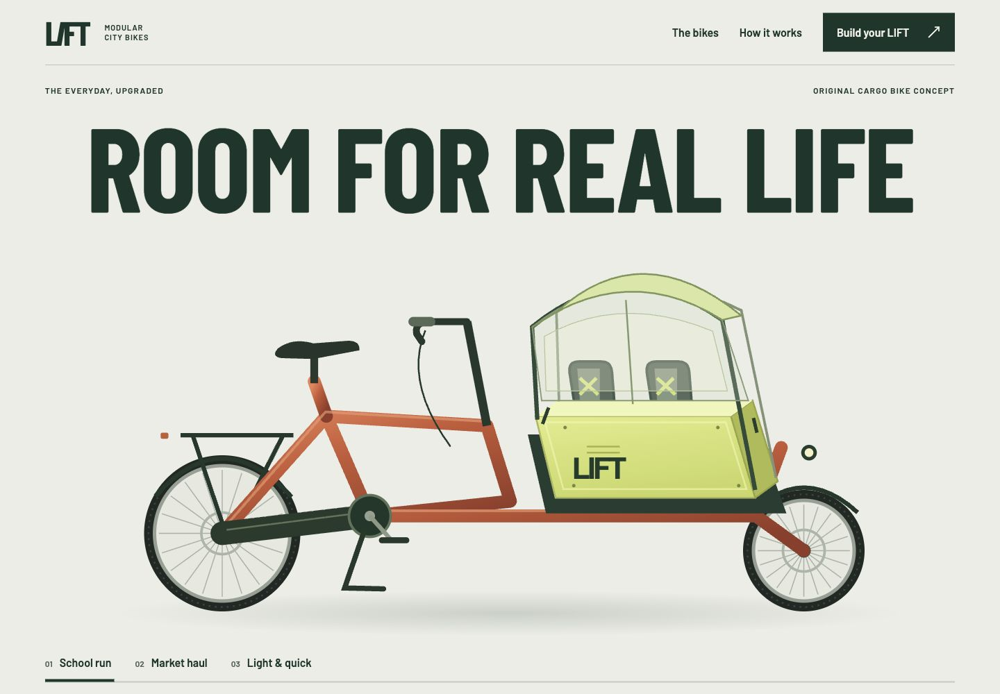

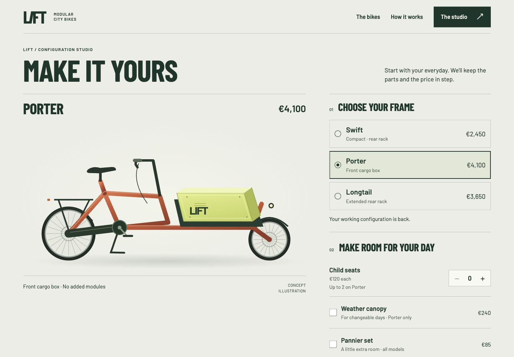

Phone views: product page and configuration studio

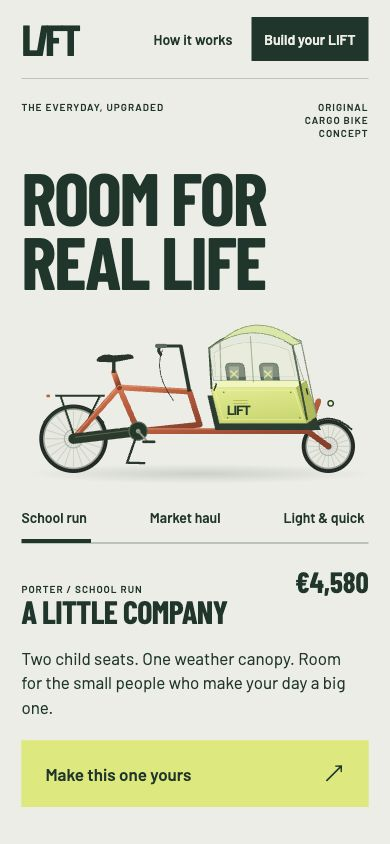
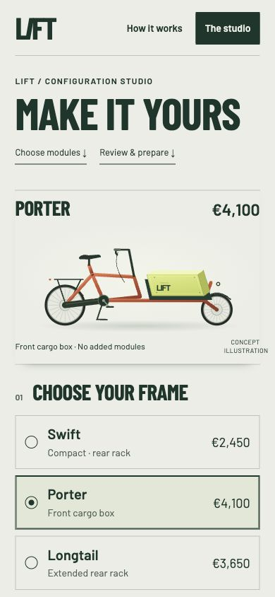

## BENCHTIME

An illustrated shared workshop connected to a session planner. Choose a day, machine and available time, keep the selected session visible while editing, and prepare a request with up to three sessions. Local save and restore preserve the request; CSV export carries the selected sessions and total. It is a demonstration planner, with sample availability and no external booking.

[Product page source](../plugins/begin-skills/skills/begin-design/assets/product-surface-cases/benchtime/site/index.html) · [Session planner](../plugins/begin-skills/skills/begin-design/assets/product-surface-cases/benchtime/site/planner.html) · [Operation guide](../plugins/begin-skills/skills/begin-design/assets/product-surface-cases/benchtime/site/guide.html) · Local path: `/product-surface-cases/benchtime/site/`

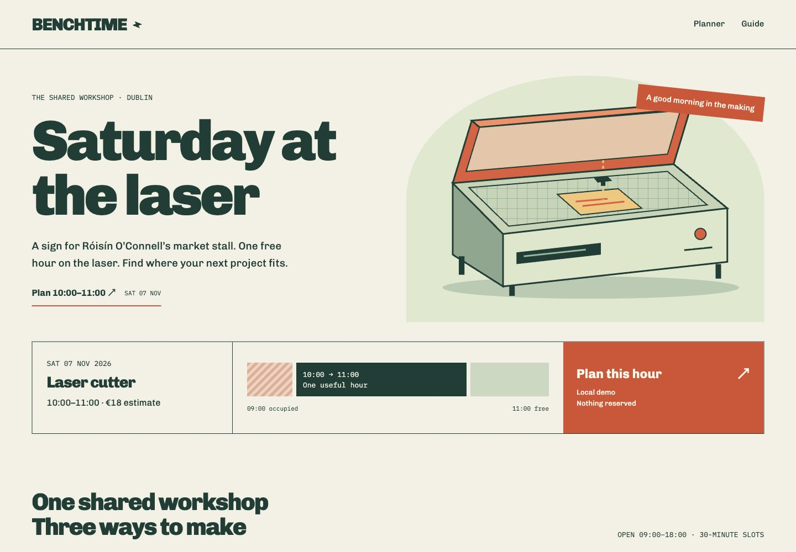

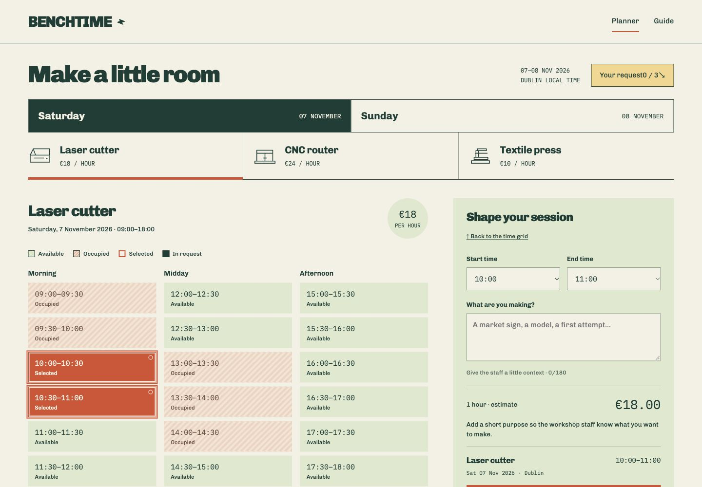

Phone views: product page and session planner

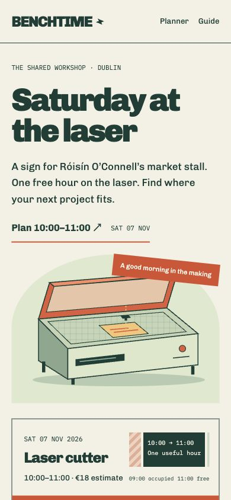
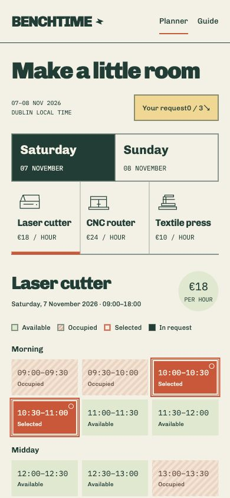

## CUTLINE

A dark documentary editing room with original illustrated frames. Open a clip, accept or reject local correction suggestions, edit subtitle text and timings, then review and approve that exact revision before downloading UTF-8 SRT. Further changes start a fresh review. The example includes local checkpoints and a guide; the frames are still illustrations without video playback.

[Product page source](../plugins/begin-skills/skills/begin-design/assets/product-surface-cases/cutline/site/index.html) · [Subtitle editor](../plugins/begin-skills/skills/begin-design/assets/product-surface-cases/cutline/site/editor.html) · [Operation guide](../plugins/begin-skills/skills/begin-design/assets/product-surface-cases/cutline/site/guide.html) · Local path: `/product-surface-cases/cutline/site/`

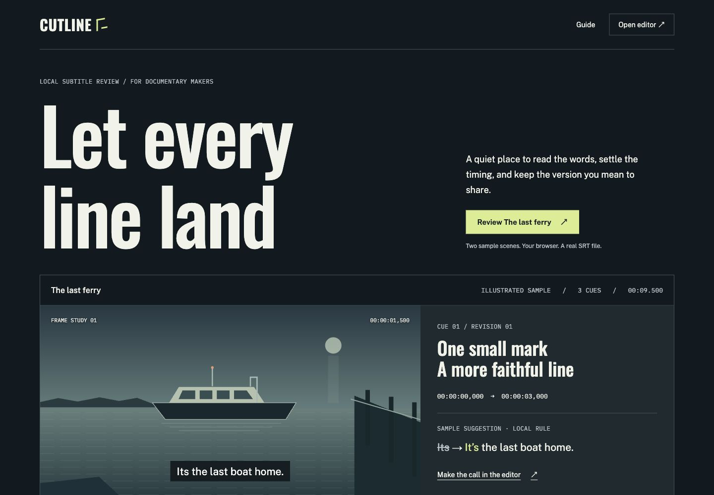

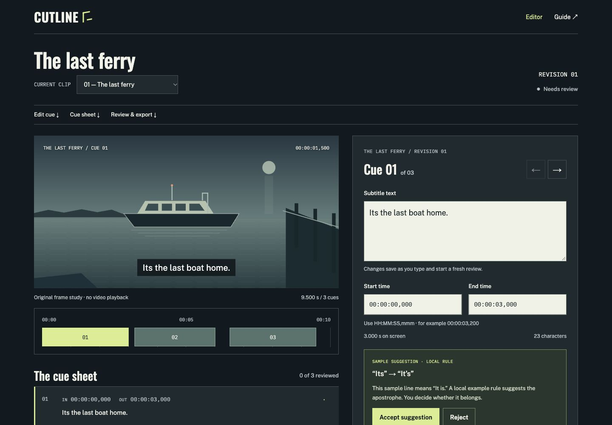

Phone views: product page and subtitle editor

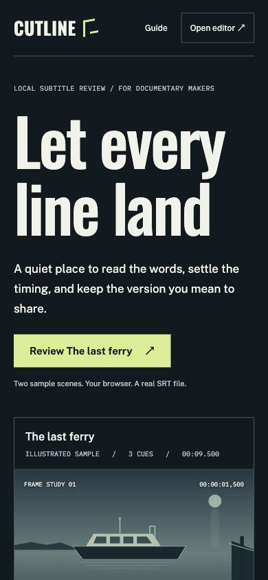
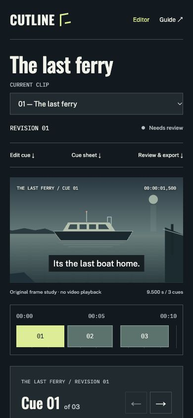

## Offset Studio

A creative portfolio led by a wall of original posters, identities and publications. Open a project and build a selection of work.

[Editable source](../plugins/begin-skills/skills/begin-design/assets/composition-cases/offset/site/index.html) · [Example guide](../plugins/begin-skills/skills/begin-design/assets/composition-cases/offset/site/guide.html) · Local path: `/composition-cases/offset/site/`

Phone view

## AFTERIMAGE

A waterfront arts festival with a dark identity, large editorial type and original light-installation illustrations. Its programme helps visitors plan an evening.

[Editable source](../plugins/begin-skills/skills/begin-design/assets/interaction-cases/afterimage/site/index.html) · [Visit guide](../plugins/begin-skills/skills/begin-design/assets/interaction-cases/afterimage/site/guide.html) · Local path: `/interaction-cases/afterimage/site/`

Phone view

## LOOP

An expressive refill-shop website with a centered headline and original product illustrations. Visitors can prepare a collection list and check their containers.

[Editable source](../plugins/begin-skills/skills/begin-design/assets/interaction-cases/loop/site/index.html) · [Container guide](../plugins/begin-skills/skills/begin-design/assets/interaction-cases/loop/site/guide.html) · Local path: `/interaction-cases/loop/site/`

Phone view

## MORA

A restrained product website for a configurable task light. Changing the arm, shade or finish updates the light and its specification.

[Editable source](../plugins/begin-skills/skills/begin-design/assets/motion-cases/mora/site/index.html) · [Configurator source](../plugins/begin-skills/skills/begin-design/assets/motion-cases/mora/site/configure.html) · [Operation guide](../plugins/begin-skills/skills/begin-design/assets/motion-cases/mora/site/guide.html) · Local path: `/motion-cases/mora/site/`

Phone view

## Down to the Moon

An independent Apollo 11 reader with editorial typography, a chapter timeline and original explanatory diagrams. Reading controls and local notes support a longer visit.

[Editable source](../plugins/begin-skills/skills/begin-design/assets/motion-cases/apollo/site/index.html) · [Sources and guide](../plugins/begin-skills/skills/begin-design/assets/motion-cases/apollo/site/guide.html) · Local path: `/motion-cases/apollo/site/`

Phone view

## Relay

A developer-product website with precise typography, a request specimen and aligned pricing information. A local estimator turns usage choices into a cost breakdown.

[Editable source](../plugins/begin-skills/skills/begin-design/assets/type-transfer-cases/relay/site/index.html) · [Estimator source](../plugins/begin-skills/skills/begin-design/assets/type-transfer-cases/relay/site/demo.html) · [Usage guide](../plugins/begin-skills/skills/begin-design/assets/type-transfer-cases/relay/site/guide.html) · Local path: `/type-transfer-cases/relay/site/`

Phone view

## Try an example

Follow the [local preview command](../README.md#explore-a-complete-example), then open one of the paths above. Keep the complete `site/` folder together when copying an example; fonts, artwork, scripts and notices are part of it.

The older six examples were captured in Chromium at 1440 × 1000 CSS pixels for desktop and 390 × 844 for phone, with pixel ratios 1 and 2 respectively and reduced motion enabled. The new three preserve the original study's 1440 × 1000 and 390 × 844 native JPEG openings at pixel ratio 1. Those CSS frame sizes are local responsive observations. The [capture record](CAPTURES.json) keeps the two batches and exact hashes distinct. For LIFT and CUTLINE, it records both the original rendered source and the final release source after two query-parameter guard repairs. Their screenshots were preserved without a new render. A still shows a page's appearance; try the working source to explore its interactions.
