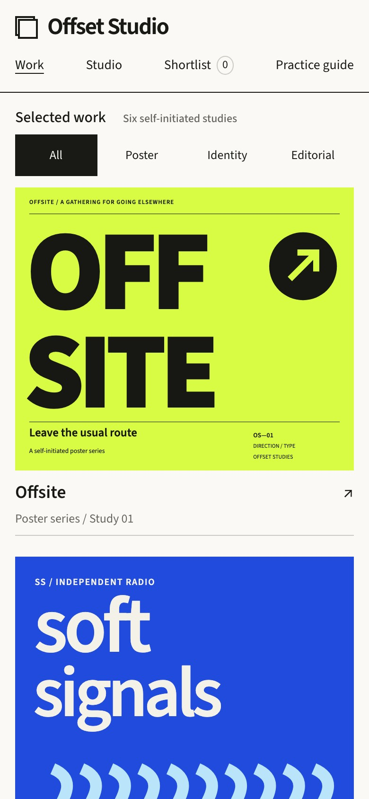
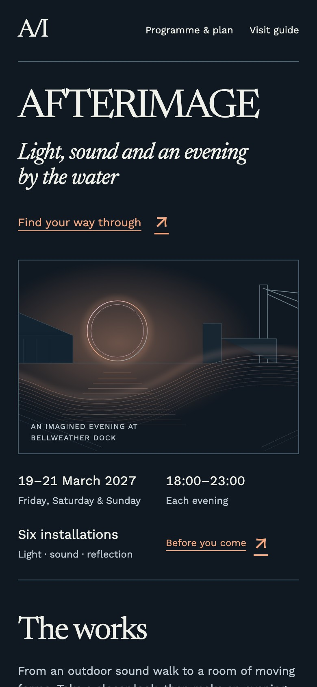
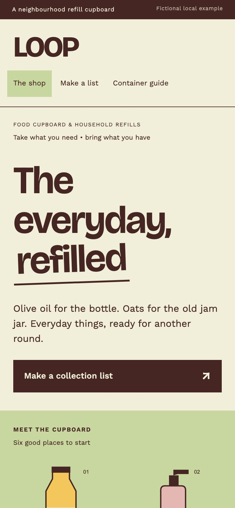
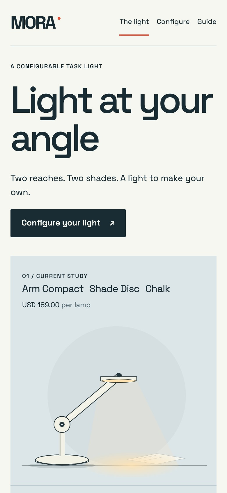
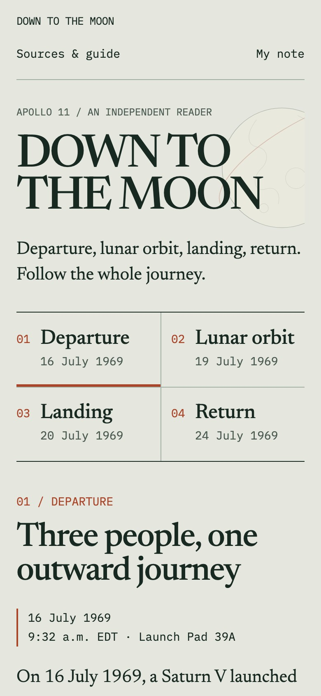
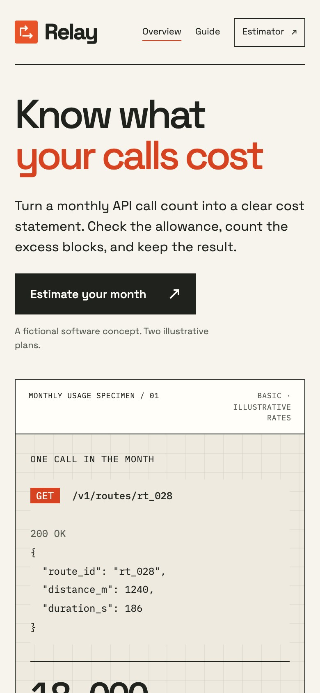

# Made with Begin

Six different briefs, six different websites. These original examples were built with Begin guidance, reviewed in the browser and refined. They are included as editable source in the pack.

The commercial examples use fictional brands and sample data; the Apollo reader uses sourced historical facts. Screenshots were captured from the actual running Beta.1 examples on 18 October 2026. They show complete browser viewports, with the examples' own fonts and artwork. No decorative device frames or replacement artwork were added.

[Back to Begin](../README.md) · [Capture details](CAPTURES.json) · [Credits and license scope](NOTICES.md)

## Offset Studio

A creative portfolio led by a wall of original posters, identities and publications. Open a project and build a selection of work.

[Editable source](../plugins/begin-skills/skills/begin-design/assets/composition-cases/offset/site/index.html) · [Example guide](../plugins/begin-skills/skills/begin-design/assets/composition-cases/offset/site/guide.html) · Local path: `/composition-cases/offset/site/`

Phone view

## AFTERIMAGE

A waterfront arts festival with a dark identity, large editorial type and original light-installation illustrations. Its programme helps visitors plan an evening.

[Editable source](../plugins/begin-skills/skills/begin-design/assets/interaction-cases/afterimage/site/index.html) · [Visit guide](../plugins/begin-skills/skills/begin-design/assets/interaction-cases/afterimage/site/guide.html) · Local path: `/interaction-cases/afterimage/site/`

Phone view

## LOOP

An expressive refill-shop website with a centered headline and original product illustrations. Visitors can prepare a collection list and check their containers.

[Editable source](../plugins/begin-skills/skills/begin-design/assets/interaction-cases/loop/site/index.html) · [Container guide](../plugins/begin-skills/skills/begin-design/assets/interaction-cases/loop/site/guide.html) · Local path: `/interaction-cases/loop/site/`

Phone view

## MORA

A restrained product website for a configurable task light. Changing the arm, shade or finish updates the light and its specification.

[Editable source](../plugins/begin-skills/skills/begin-design/assets/motion-cases/mora/site/index.html) · [Configurator source](../plugins/begin-skills/skills/begin-design/assets/motion-cases/mora/site/configure.html) · [Operation guide](../plugins/begin-skills/skills/begin-design/assets/motion-cases/mora/site/guide.html) · Local path: `/motion-cases/mora/site/`

Phone view

## Down to the Moon

An independent Apollo 11 reader with editorial typography, a chapter timeline and original explanatory diagrams. Reading controls and local notes support a longer visit.

[Editable source](../plugins/begin-skills/skills/begin-design/assets/motion-cases/apollo/site/index.html) · [Sources and guide](../plugins/begin-skills/skills/begin-design/assets/motion-cases/apollo/site/guide.html) · Local path: `/motion-cases/apollo/site/`

Phone view

## Relay

A developer-product website with precise typography, a request specimen and aligned pricing information. A local estimator turns usage choices into a cost breakdown.

[Editable source](../plugins/begin-skills/skills/begin-design/assets/type-transfer-cases/relay/site/index.html) · [Estimator source](../plugins/begin-skills/skills/begin-design/assets/type-transfer-cases/relay/site/demo.html) · [Usage guide](../plugins/begin-skills/skills/begin-design/assets/type-transfer-cases/relay/site/guide.html) · Local path: `/type-transfer-cases/relay/site/`

Phone view

## Try an example

Follow the [local preview command](../README.md#explore-a-complete-example), then open one of the paths above. Keep the complete `site/` folder together when copying an example; fonts, artwork, scripts and notices are part of it.

These views were captured in Chromium at 1440 × 1000 CSS pixels for desktop and 390 × 844 for phone. Desktop uses pixel ratio 1; phone uses pixel ratio 2. The browser's reduced-motion preference was enabled for stable stills. The [capture record](CAPTURES.json) identifies the exact files and source version. A still shows a page's appearance; try the working source to explore its interactions.
